# ha-todo-card

[](https://www.home-assistant.io/integrations/marketplace/)
[](https://github.com/juju35/ha-todo-card/actions/workflows/hacs.yml)
[](https://github.com/juju35/ha-todo-card/actions/workflows/validate.yml)
[](https://github.com/juju35/ha-todo-card/actions/workflows/lint.yml)
[](https://github.com/juju35/ha-todo-card/releases/latest)
[](https://github.com/juju35/ha-todo-card/blob/main/LICENSE)
[](https://buymeacoffee.com/julienstep9)

<p align="center">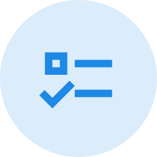</p>

<p align="center">
  &nbsp;&nbsp;
  &nbsp;&nbsp;
  &nbsp;&nbsp;
  &nbsp;&nbsp;
  &nbsp;&nbsp;
  &nbsp;&nbsp;
  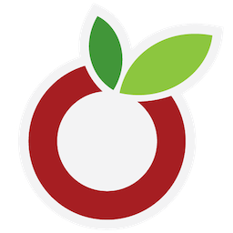&nbsp;&nbsp;
  &nbsp;&nbsp;
  &nbsp;&nbsp;
  &nbsp;&nbsp;
  &nbsp;&nbsp;
  &nbsp;&nbsp;
  &nbsp;&nbsp;
  
</p>

Lovelace cards for Home Assistant for **to-do and shopping lists**: every list of every [to-do integration](https://www.home-assistant.io/integrations/todo/) (Local To-do, Shopping list, Bring!, Todoist, Google Tasks, CalDAV, Mealie, OurGroceries…) with **tabs** between lists, items **ticked off** with a tap, a **field to add** items, **due dates** (overdue in red, today in orange), details, **renaming and deleting**, and the completed items folded away.

Every to-do list of Home Assistant is shown when nothing is configured; pick the lists you want, and the one shown first. The items are read live through Home Assistant's to-do subscription, so a change made in the app of the list shows at once.

[](https://my.home-assistant.io/redirect/marketplace_repository/?owner=juju35&repository=ha-todo-card&category=plugin)

| To-do Card | To-do Mini Card |
|---|---|
| 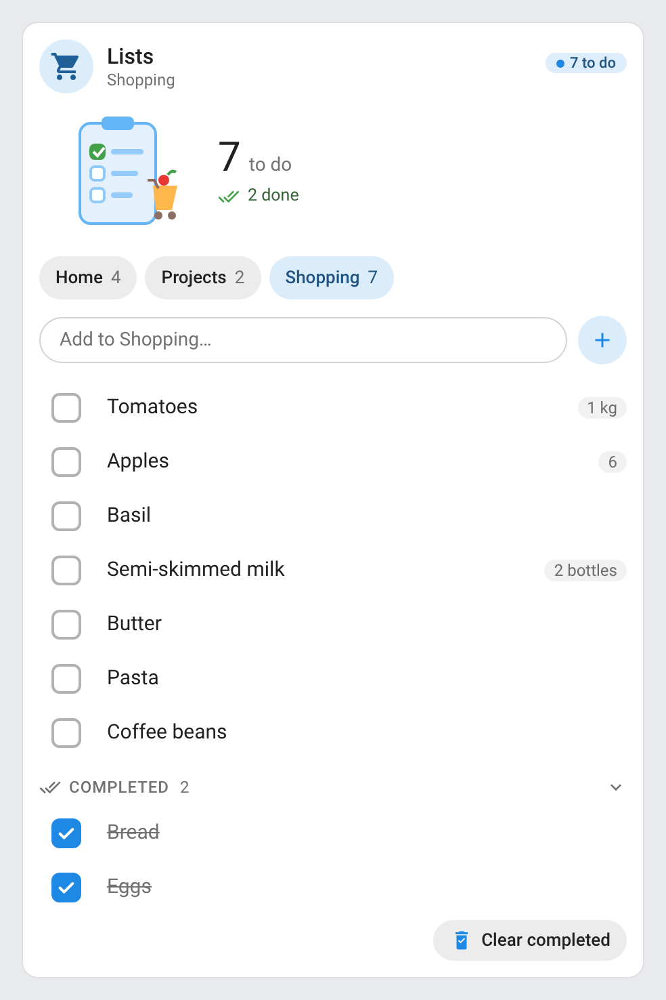 | 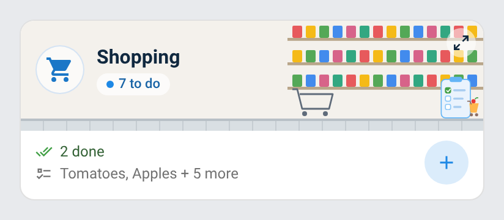<br>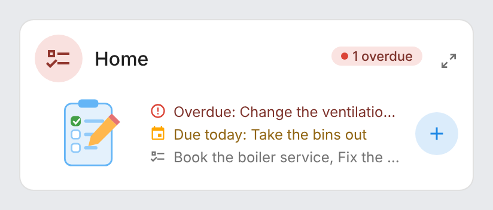 |

## Features

- Two cards: a full **To-do Card** (`custom:todo-card`) and a compact **To-do Mini Card** (`custom:todo-mini-card`): the illustrated header, what is overdue and due today, the next items and a button to add one
- **Illustrated header** (90 px, on both cards): the title on the left, an animated scene on the right over a tiled floor strip. A to-do list is stuck on a kitchen fridge (the pencil writes while items are left, a red note swings on the freezer when something is overdue, a green tick magnet and sparkles once all is done); a shopping list is at the end of a supermarket aisle, with a trolley rolling along the shelves (parked and full once all is bought). Night version with a dark Home Assistant theme, forced with `illustration_theme`; `illustration: false` brings back the classic header (see [Animations](#animations))
- A **summary** at the top: how many items are left to do, then what is overdue, due today and done (beside the clipboard illustration with the classic header)
- **Tabs** between your lists, each with its number of items to do
- **Tick off** an item with a tap on its box (and back): the box fills, the tick draws and a line strikes the item before it moves to the completed ones (see [Animations](#animations))
- **Add** items from the field at the top (Enter or +); on the mini card, + opens a popup at the top of the card
- **Due dates** under the item: overdue in red, today in orange, then tomorrow, the day or the date; a short **detail** (Bring!'s specification: *1 kg*, *6*) as a pill on the right, a longer one (a task's description) under the item
- **Edit** an item with a tap on its text: rename it, change its details or delete it, in a popup at the top of the card
- **Completed items** in a folded section, with *Clear completed*
- Header icon in a round badge (a cart for shopping lists) whose colour follows the list's state (accent: items to do, red: overdue, green: all done, grey: loading), and a status chip under the title: *7 to do*, *1 overdue*, *All done*
- **Due dates set from the card**: a date (or date and time) field in the edit popup and in the add popup (the calendar button beside the field), for the lists that take one; empty it to clear the due date
- Only the buttons a list supports: no field on a read-only list, checkboxes greyed out and no edit where items cannot be changed (a Picnic cart); items without an id are changed by their name
- Collapsible completed section, folded back to its default by a click elsewhere on the page
- Detail button on the mini card (top right): it switches the mini card to the full card's content and back; a click anywhere outside the card brings the compact view back
- Visual editor in the dashboard UI for both cards (no YAML needed)
- Light and dark mode, English, French, German, Spanish, Serbian (Cyrillic and Latin), Italian, Dutch, European Portuguese, Polish, Romanian, Danish, Swedish, Bulgarian, Russian, Ukrainian, Hungarian, Slovak, Czech, Slovenian, Latvian and Greek
- Single file, no external dependency

## Supported integrations

| Integration | What the cards use |
|---|---|
|  [Local To-do](https://www.home-assistant.io/integrations/local_todo/) and [Shopping list](https://www.home-assistant.io/integrations/shopping_list/) (core) | Everything: add, tick off, rename, details, due dates (set and changed from the card), delete |
|  [Bring!](https://www.home-assistant.io/integrations/bring/) (core) | Items with their specification as details |
|  [Todoist](https://www.home-assistant.io/integrations/todoist/) (core) | Tasks with due dates (set from the card) and descriptions |
|  [Google Tasks](https://www.home-assistant.io/integrations/google_tasks/) (core) | Tasks with due dates and notes |
|  [CalDAV](https://www.home-assistant.io/integrations/caldav/) (core) | Task lists (Nextcloud, iCloud and other CalDAV servers) |
|  [Mealie](https://www.home-assistant.io/integrations/mealie/) (core) | Shopping lists |
|  [OurGroceries](https://www.home-assistant.io/integrations/ourgroceries/) (core) | Shopping lists |
|  [AnyList](https://www.home-assistant.io/integrations/any_list/) (core) | Lists |
|  [Picnic](https://www.home-assistant.io/integrations/picnic/) (core) | The cart |
|  [Cookidoo](https://www.home-assistant.io/integrations/cookidoo/) (core) | Shopping list and additional items |
|  [Habitica](https://www.home-assistant.io/integrations/habitica/) (core) | To-dos and dailies |
|  [Remember The Milk](https://www.home-assistant.io/integrations/remember_the_milk/) (core) | Lists |
|  [Apple iCloud](https://www.home-assistant.io/integrations/icloud/) (core) | Reminders |
|  [Alexa Devices](https://www.home-assistant.io/integrations/alexa_devices/) (core) | Alexa shopping and to-do lists |
|  [AnyList](https://github.com/ozonejunkieau/ha-anylist) (custom) | Shopping lists |
| [Grocy](https://github.com/custom-components/grocy) (custom) | Shopping list and chores |
| [KitchenOwl](https://github.com/TomBursch/kitchenowl-ha) (custom) | Shopping lists |
| Any other to-do integration | Its lists: what it supports (its `supported_features`) decides which buttons show |

The cards use Home Assistant's to-do entities and services (`todo.add_item`, `todo.update_item`, `todo.remove_item`, `todo.remove_completed_items`), so they work with any integration that provides a to-do list.

## Prerequisites

Home Assistant 2024.8 or later, with at least one to-do list.

## Installation

### Via the Marketplace (recommended)

Click the button below to add the repository directly:

[](https://my.home-assistant.io/redirect/marketplace_repository/?owner=juju35&repository=ha-todo-card&category=plugin)

Then click **Install**, and reload your browser when the Marketplace asks you to.

Or manually:

1. Open **Settings → Marketplace → Add from link** (top right; this needs a GitHub account connected)
2. Add `https://github.com/juju35/ha-todo-card` — Type: **Dashboard**
3. Open **To-do Card** and click **Install**
4. Clear your browser cache and refresh

The Marketplace adds the resource `/local/community/ha-todo-card/todo-card.js` for you.

### Manual

1. Download `todo-card.js` and the `todo-card.i18n.*.js` translation files from the [latest release](https://github.com/juju35/ha-todo-card/releases/latest)
2. Copy them all to `/config/www/` (without the translation files, the cards show in English)
3. Go to **Settings → Dashboards → ⋮ → Resources** → Add resource:
   - URL: `/local/todo-card.js`
   - Type: **JavaScript Module**
4. Clear your browser cache and refresh

## Configuration

### Card types

| Card | Type |
|---|---|
| To-do Card | `custom:todo-card` |
| To-do Mini Card | `custom:todo-mini-card` |

### Visual editor

Edit a dashboard, click **Add card** and search for **To-do Card** or **To-do Mini Card**. Every list is shown when the list of lists is left empty; pick the lists, the one shown first, the order of the items, how many to show, the sections and the language. The preview updates live, and options left at their default are kept out of the generated YAML.

### Minimal

```yaml
type: custom:todo-card
```

```yaml
type: custom:todo-mini-card
```

### Full options

```yaml
type: custom:todo-card
title: Lists
entities:
  - todo.shopping_list
  - entity: todo.home
    name: House
entity: todo.shopping_list
sort: due
max_items: 10
illustration: true
illustration_theme: auto
show_title: true
show_subtitle: true
show_hero: true
show_tabs: true
show_add: true
show_completed: true
collapsed:
  - completed
language: en
```

```yaml
type: custom:todo-mini-card
entity: todo.shopping_list
max_items: 4
zoom: true
```

### Options reference

| Option | Card | Default | Description |
|---|---|---|---|
| `title` | both | The list's name (Lists with tabs) | Card title |
| `show_title` | both | `true` | Show the title in the header |
| `show_subtitle` | full | `true` | Show the subtitle (the list shown, or how many items to do) |
| `illustration` | both | `true` | Illustrated, animated header (kitchen fridge or supermarket aisle, following the list's state). `false`: the classic header, with the clipboard illustration in the summary |
| `illustration_theme` | both | `auto` | Header picture: `auto` (follows the Home Assistant theme: night with a dark theme, day with a light theme), `day` or `night` |
| `show_hero` | both | `true` | Summary (full card); with `illustration: false`, the clipboard illustration too (full and mini card) |
| `entities` | both | Every list | To-do lists: entity ids, or objects with `entity` and `name` |
| `entity` | both | First list | List shown first (the mini card shows this one) |
| `sort` | both | `manual` | Order of the items to do: `manual` (as the list keeps them), `due` (by due date, undated last) or `alpha` |
| `max_items` | both | All (mini: 2) | How many items to do are shown (the mini card names them after the overdue and today's ones); the others are counted (*+ 4 more*) |
| `show_tabs` | full | `true` | Tabs between the lists (with several lists) |
| `show_add` | both | `true` | Field (full card) or button (mini card) to add an item |
| `show_completed` | both | `true` | Completed items section |
| `collapsed` | both | `[completed]` | Sections folded by default: `completed`. Click its title (or Tab to it and press Enter or Space) to fold or unfold it; `[]` shows it unfolded |
| `zoom` | mini | `true` | Detail button at the top right of the mini card: it shows the full card's content (with the same options, which can be set on the mini card too, in its visual editor as well) and switches back to the compact view; a click outside the card also brings the compact view back. `false` removes the button |
| `language` | both | Auto | Force language: `fr`, `en`, `de`, `es`, `sr`, `sr-Latn`, `it`, `nl`, `pt`, `pl`, `ro`, `da`, `sv`, `bg`, `ru`, `uk`, `hu`, `sk`, `cs`, `sl`, `lv` or `el` (auto-detects from HA settings) |

`entities` as objects are YAML only; the visual editor edits them as a list of entities.

## Screenshots

### Animations

An item ticked off: its box fills, its tick draws and a line strikes it, then it moves to the completed items; the animation honours `prefers-reduced-motion`:

| Light | Dark |
|---|---|
| 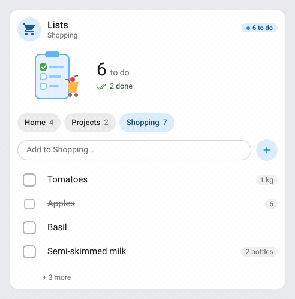 | 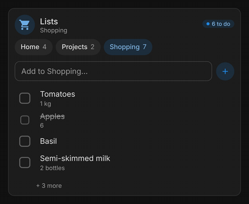 |

The illustrated header follows the list's state: items left (the pencil writes), something overdue (the red note swings), all done (tick magnet and sparkles), and a shopping list (the trolley rolls along the aisle). The dark captures show the night version:

| Light | Dark |
|---|---|
| 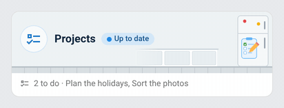 | 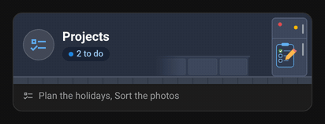 |
| 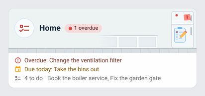 | 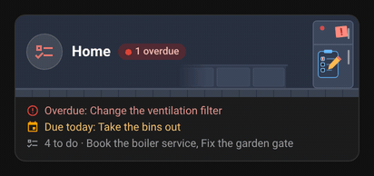 |
| 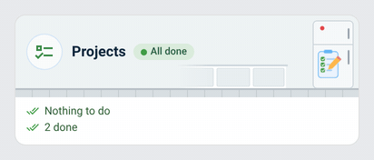 | 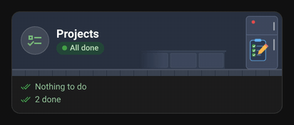 |
| 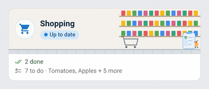 | 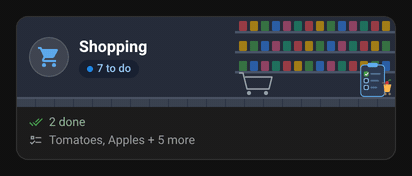 |

### Full card

The shopping list of Bring!, with the details of each item, the completed ones unfolded:

| Light | Dark |
|---|---|
|  | 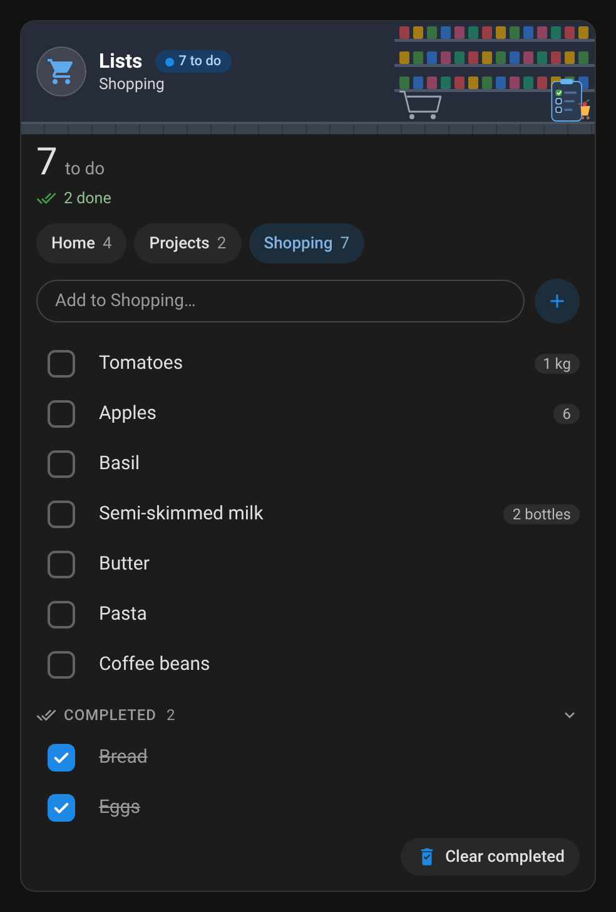 |

The home tasks of Local To-do: one overdue, one due tonight:

| Light | Dark |
|---|---|
| 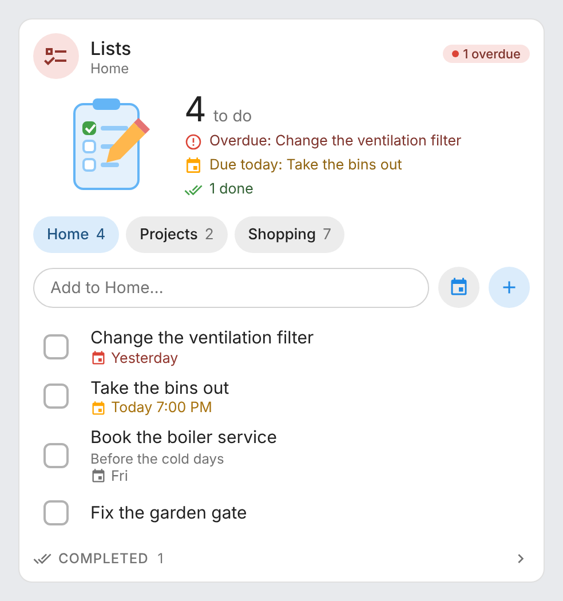 | 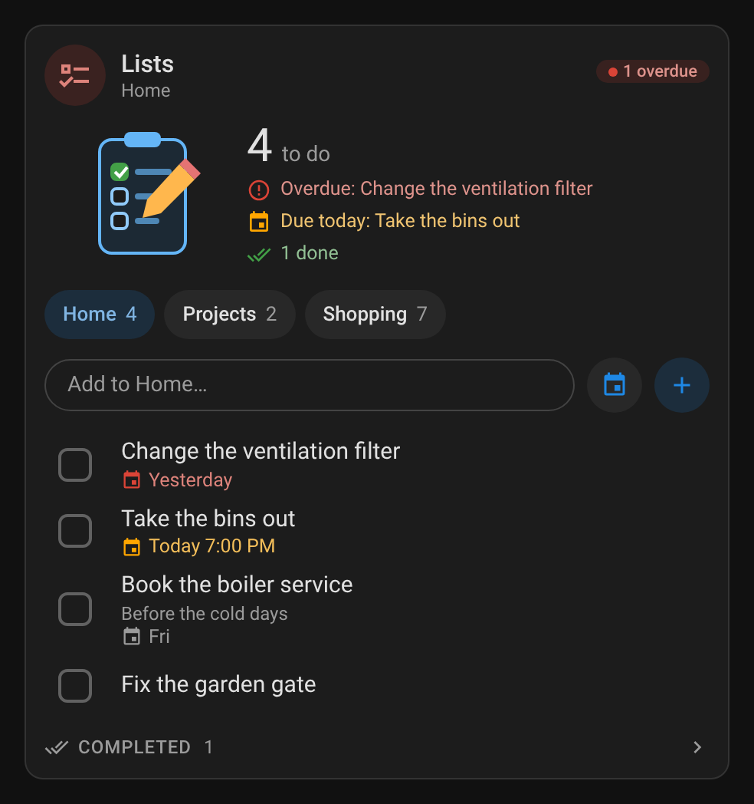 |

A tap on an item's text: rename it, change its details or delete it:

| Light | Dark |
|---|---|
| 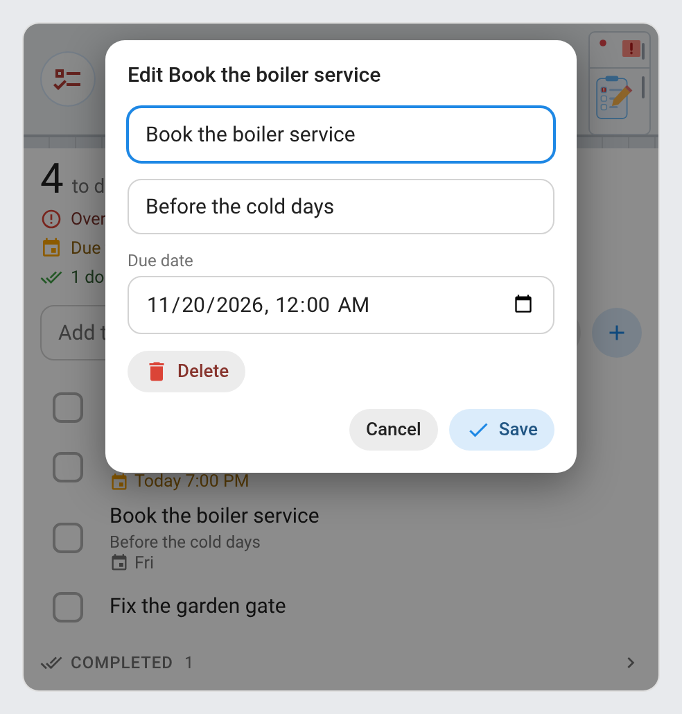 | 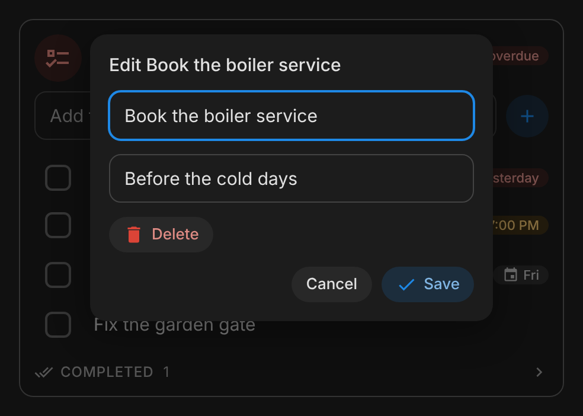 |

### Mini card

| Light | Dark |
|---|---|
|  | 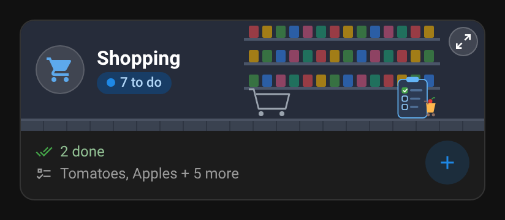 |
|  | 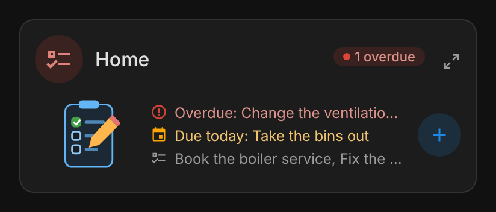 |

The detail button (top right) shows the full card's content:

| Light | Dark |
|---|---|
| 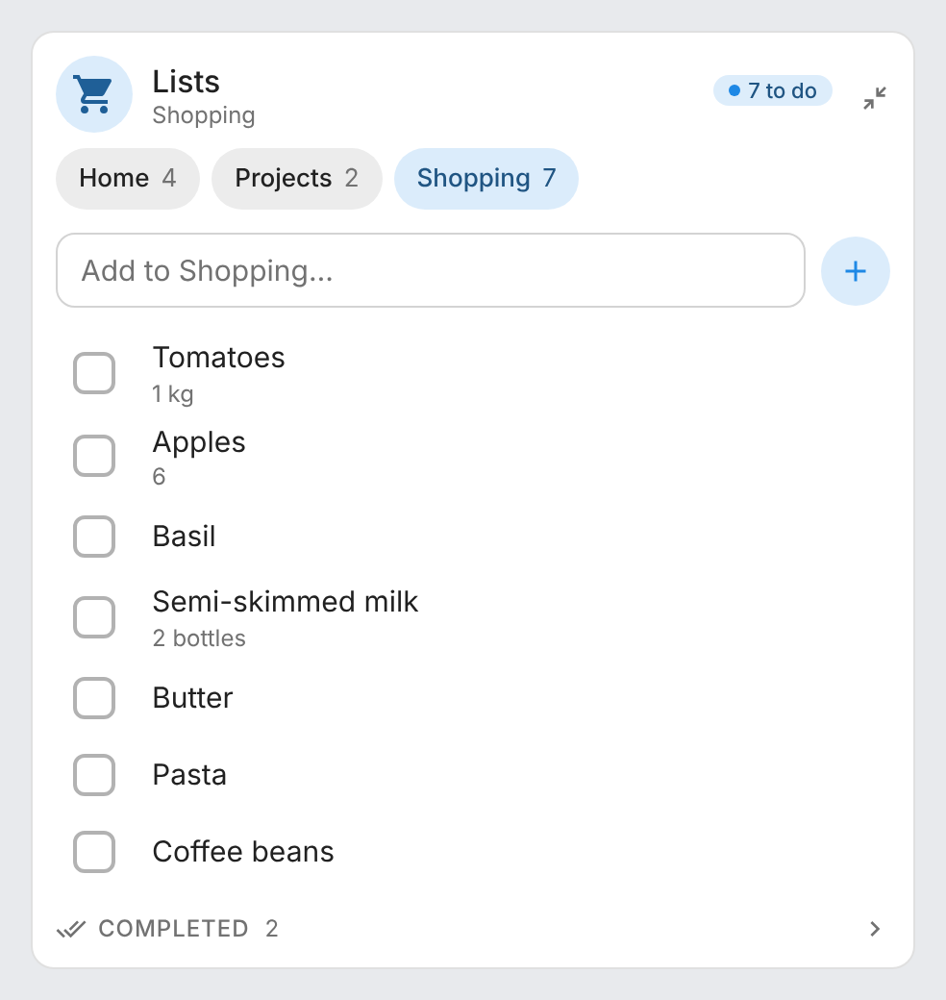 | 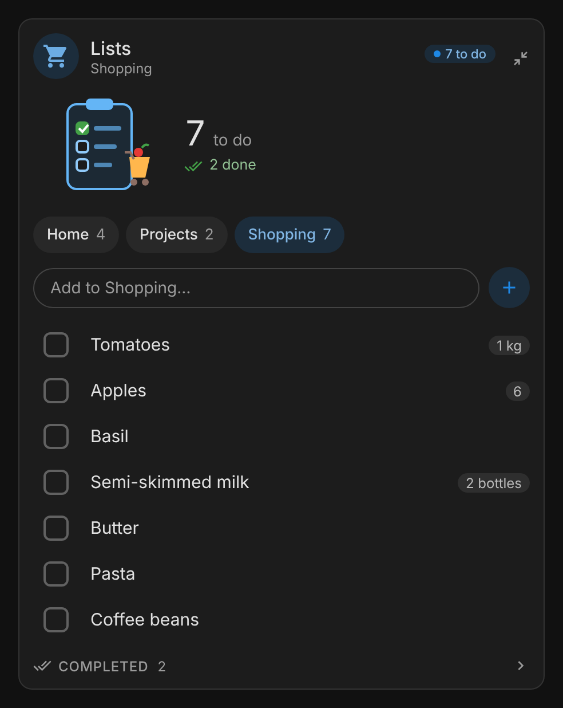 |

### Narrow cards

The full card at 6 columns of a phone's Sections view and the mini card at its minimum width:

| Light | Dark |
|---|---|
| 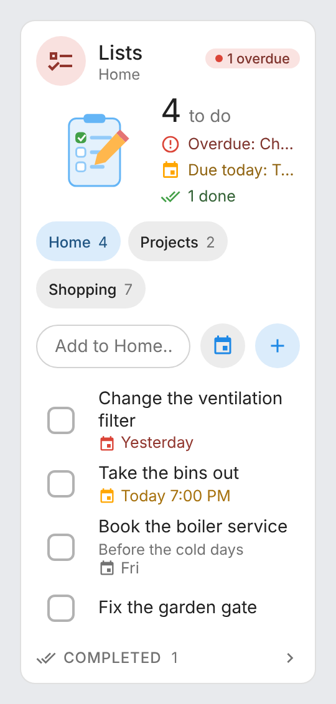 | 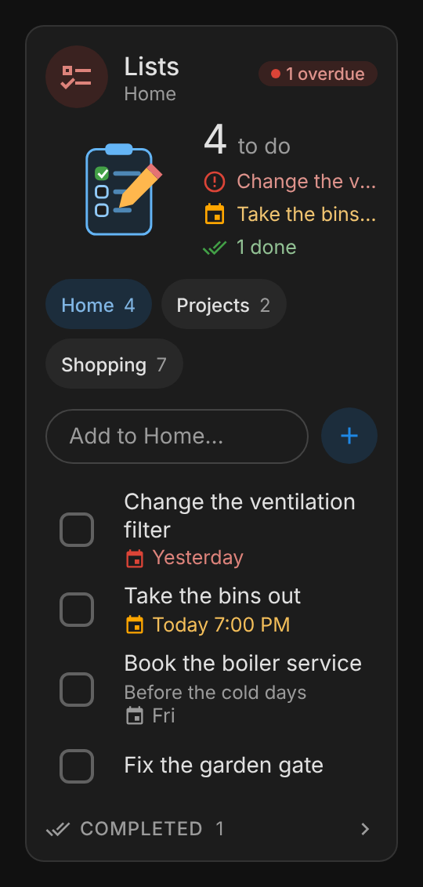 |
| 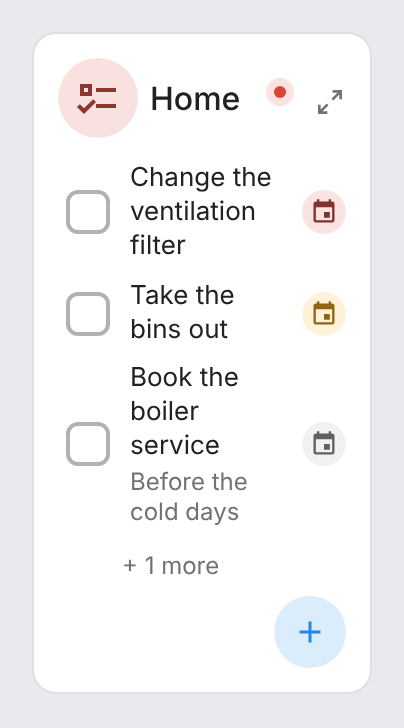 | 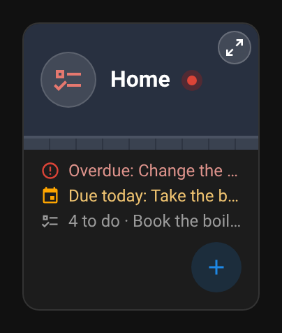 |

## How it works

- **Lists** are the `todo.*` entities; their state is the number of items to do, which the tabs show.
- **Items** come from Home Assistant's to-do subscription (`todo/item/subscribe`) for the list shown, which pushes every change; switching tabs subscribes to the other list.
- **Features**: each list says what it supports (create, delete, update, due date, description); the card shows only the matching field and buttons.
- **Due dates**: a date is overdue from the next day, a date and time from that time; today's in orange.
- **Ticking off** calls `todo.update_item` with the new status; the item shows its tick for a moment, then moves where the list puts it.

## Development

```bash
npm install
npm run build        # bundles src/todo-card.js into dist/todo-card.js (and its translation files)
npm run check        # builds and checks the card (run in CI)
npm test             # unit tests
npm run screenshots  # renders the cards (and one GIF per animated state, needs ffmpeg) with mock data into screenshots/
```

`dist/` is not committed: `npm run build` creates it locally, CI builds it on every push, and the release workflow attaches the built files to the release, which is where the Marketplace installs it from. The captures are rendered on a fixed clock with mock data (scripts/mock-states.mjs) and rewritten only when their pixels change, exactly; on a pull request, the **Screenshots** workflow commits them to the pull request's branch.

### Releasing

1. Bump `version` in `package.json` (and `package-lock.json`, with `npm install`)
2. Add a `## <version>` section at the top of [CHANGELOG.md](https://github.com/juju35/ha-todo-card/blob/main/CHANGELOG.md)
3. Push to `main`: the **Release** workflow builds the card, creates the tag and the GitHub release with the changelog section as notes, and attaches `todo-card.js` and its translation files

## Translations

The cards auto-detect the language from your Home Assistant settings. Currently supported:

| Language | Code |
|---|---|
| English | `en` |
| Français | `fr` |
| Deutsch | `de` |
| Español | `es` |
| Српски | `sr` |
| Srpski (latinica) | `sr-Latn` |
| Italiano | `it` |
| Nederlands | `nl` |
| Português (European; also used for `pt-BR`) | `pt` |
| Polski | `pl` |
| Română | `ro` |
| Dansk | `da` |
| Svenska | `sv` |
| Български | `bg` |
| Русский | `ru` |
| Українська | `uk` |
| Magyar | `hu` |
| Slovenčina | `sk` |
| Čeština | `cs` |
| Slovenščina | `sl` |
| Latviešu | `lv` |
| Ελληνικά | `el` |

English is in the card's file; every other language is in its own small file (`todo-card.i18n.<lang>.js`), loaded only when needed. Contributions for additional languages are welcome!

## Credits

Bring!, Todoist, Google Tasks, Mealie, OurGroceries, AnyList, Picnic, Cookidoo, Habitica, Remember The Milk, iCloud and Alexa are trademarks of their respective owners. This project is not affiliated with any of them. Icons from [Material Design Icons](https://pictogrammers.com/library/mdi/).

## License

[MIT](https://github.com/juju35/ha-todo-card/blob/main/LICENSE)

## Support

If you find this project useful, you can support its development:

<a href="https://buymeacoffee.com/julienstep9"></a>
